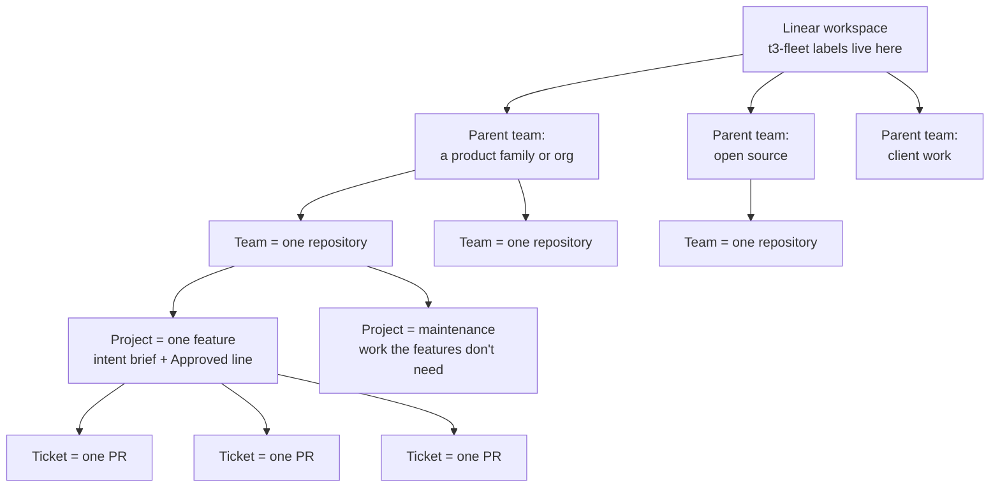
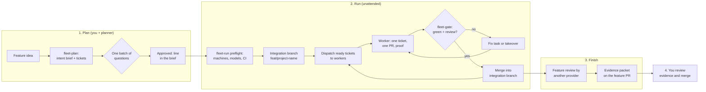
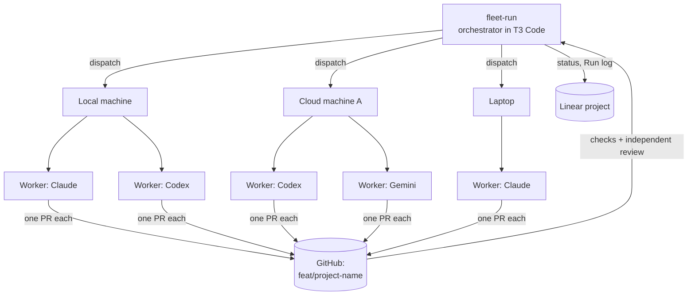

<p align="center">
  <a href="https://fantastic.dev"></a>
</p>

<h1 align="center">T3 Linear Fleet</h1>

<p align="center"><strong>Plan a feature in Linear, then let a fleet of agents build it, get it green, and hand you the evidence.</strong></p>

<p align="center">A <a href="https://fantastic.dev">Fantastic.Dev</a> Project</p>

<p align="center">
  <a href="https://fantastic.dev"></a>
  <a href="https://github.com/FantasticDevHQ"></a>
  <a href="https://www.youtube.com/@FantasticDevHQ"></a>
  <a href="https://twitter.com/FantasticDevHQ"></a>
</p>

<p align="center">
  <a href="https://github.com/FantasticDevHQ/t3-linear-fleet/actions/workflows/check.yml"></a>
  <a href="LICENSE"></a>
</p>

<p align="center"><a href="#quick-start">Quick start</a> · <a href="#how-i-work">How I work</a> · <a href="#how-it-works">How it works</a> · <a href="#why-it-works-this-way">Why</a> · <a href="#linear-setup">Linear setup</a> · <a href="#skills">Skills</a></p>

---

T3 Linear Fleet is a set of agent skills for solo developers who plan in [Linear](https://linear.app) and run coding agents through [T3 Code](https://github.com/pingdotgg/t3code). You plan a feature once. A fleet of agents builds it in parallel across your machines and model providers, gets everything green, and hands you evidence to review. You don't have to watch over them.

> **Unofficial.** Not affiliated with T3, T3 Code, or their authors.

## Quick start

### Have my agent set this up

Copy this into your coding agent (Claude Code, Codex, or another agent that supports skills), in any directory:

```text
Install the T3 Linear Fleet skills from https://github.com/FantasticDevHQ/t3-linear-fleet
for my coding agents, using the public `skills` CLI (https://skills.sh).

1. Check that Node.js 22 or newer and npx are available. Stop and tell me if not.
2. Run `npx skills@latest add FantasticDevHQ/t3-linear-fleet --list` and show me
   the available skills.
3. Install them globally for the agents I use:
   `npx skills@latest add FantasticDevHQ/t3-linear-fleet --global --skill '*'`
   Ask me which agents to target if the CLI cannot detect them.
4. Verify with `npx skills@latest list --global` that `fleet-plan` is installed.
5. Check whether my agent can reach Linear, through either:
   - the Linear MCP server (https://linear.app/docs/mcp), at
     https://mcp.linear.app/mcp, or
   - linear-cli (https://github.com/nesszer/linear-cli): `linear-cli --version`.
   If neither works, tell me how to connect the MCP server for my agent, or how
   to install linear-cli (`cargo install linear-cli`) and authenticate it
   (`linear-cli setup`). Do not ask me for an API key in chat. Do not create,
   edit, or delete any Linear data. Only report whether access is available.
6. Check that T3 Code (https://github.com/pingdotgg/t3code) is how I run my
   agents if I want to use fleet-run; it needs T3 Code's orchestration tools.

Report the commands you ran, the installed skills, the agents they were linked
to, and whether Linear access is ready. Do not claim anything you did not verify.
```

### Manual setup

Requires Node.js 22 or newer with npx. Using the skills also needs a Linear workspace, connected through either:

- the [Linear MCP server](https://linear.app/docs/mcp) at `https://mcp.linear.app/mcp`, added to your agent; or
- [linear-cli](https://github.com/nesszer/linear-cli): `cargo install linear-cli`, then `linear-cli setup`.

`fleet-run` also needs [T3 Code](https://github.com/pingdotgg/t3code), which provides the orchestration tools.

List the skills, then install them globally:

```sh
npx skills@latest add FantasticDevHQ/t3-linear-fleet --list
npx skills@latest add FantasticDevHQ/t3-linear-fleet --global --skill '*'
```

Verify the install:

```sh
npx skills@latest list --global
```

Expected result: `fleet-plan` appears in the list for your agents. Then ask your agent to "set up the fleet" (`fleet-setup`), and "plan this feature with fleet-plan" to start a Linear plan.

## How I work

This is the setup the skills were built around. It is not required, but the skills assume its shape.



- **One team per repository.** Each repository gets its own Linear team, with its own ticket prefix (for example `ENG-123`). A ticket ID tells you which codebase it belongs to, branches and commits carry it, and the team's GitHub automation only has to know one repository.
- **Parent teams group related repositories.** Products from the same family, open-source tools, and client work each sit under their own parent team. Shared labels can live on a parent team so every repository team below inherits them.
- **Labels that every team needs live at the workspace.** The `t3-fleet` group is used by teams under every parent, so it lives at the workspace. Linear label names must be unique across the workspace and all teams, which is why each fleet label has the `t3-fleet-` prefix.
- **A project is one feature.** The project description is the intent brief: problem, users, definition of done, non-goals, constraints, decisions, release checks, and a dependency graph of every ticket. `fleet-plan` writes it; `fleet-refresh` brings older projects up to it.
- **A ticket is one PR.** It has an outcome, numbered requirements, acceptance criteria with `Verify` and `Evidence`, a design image for UI work, and a Fleet section that names its model and effort.
- **Work the feature doesn't need goes elsewhere.** Follow-ups found during a feature (tooling, flaky tests, lint) move to a separate maintenance project of the same team, so a feature's run stays focused on its definition of done.
- **Done means merged.** A ticket is Done when its work reaches the default branch. Before that, a merge into the feature branch moves it to an "Integrated" status, or leaves it as it was if you chose "no action".

## How it works

A feature goes through four stages. You talk to the agent in the first stage and review in the last. The middle runs unattended. It pauses only for what the orchestrator cannot settle itself, for example a costly or irreversible decision, a conflict with the intent brief, or a ticket that stays blocked after a takeover. It asks all of these in one batch. The full list is in `fleet-run`'s [Escalations](./skills/fleet-run/SKILL.md#escalations) section.



Workers spread across your machines and model providers. The orchestrator picks each ticket's model from the ticket's Fleet section. Every ticket PR must pass its checks and an independent review by a capable model from a different provider than the one that wrote it. Risky tickets and the finished feature get the strongest reviewer:



## Why it works this way

Each choice answers a problem that shows up when agents build features unattended.

- **Almost all talking happens up front.** An agent that has to ask a question halfway through either stops or guesses. So `fleet-plan` settles every product decision before a ticket exists. It asks one short question first if the goal is unclear, then the rest in one batch with recommended defaults, and records the answers in the brief. During the run, workers never ask you. The orchestrator escalates only what it cannot settle itself (see `fleet-run`'s Escalations section), batches it, and asks when nothing else can proceed.
- **Acceptance happens inside the PR.** A criterion that can only be checked after merge or in production blocks the merge forever, so an unattended agent loops, skips it, or asks. Every criterion has a `Verify` line that runs on the PR (a test, CI, a remote end-to-end run) and an `Evidence` line it produces. Things that can only be checked after release go in a separate, non-blocking list.
- **The least change.** Each ticket is the least change that meets its outcome, and the plan is the fewest tickets that meet the definition of done. Once the plan is approved, the run does not add or widen tickets on its own: ideas found during the run come back to you as a list of possible follow-ups, and a real gap in the plan is put to you as a question (add one ticket, change the definition of done, or stop).
- **Few, meaningful tickets.** One ticket is one reviewable PR with one outcome. There is no point cap: splitting work to fit an estimate makes slivers that share context and multiply review overhead.
- **One integration branch per feature.** Ticket PRs merge into `feat/<project>`, not `main`. The feature lands as one PR you review once, with the evidence for the whole feature. `main` stays releasable the whole time.
- **Commits carry the ticket, not PR titles.** Every commit says `Fixes ENG-123` or `Refs ENG-123`, which Linear's GitHub integration reads. Branch rules move a ticket to an "Integrated" status (or take no action) when it merges into the feature branch, and to Done when the feature reaches `main`. If those rules are missing, `fleet-run` corrects the statuses by hand.
- **The right model for each ticket.** You rate your favorite models once for intelligence, taste, and cost (`fleet-models`). Each ticket then gets the candidate that fits its risk and kind of work, weighing intelligence first, then taste, then cost: mechanical work can go to a cheaper model, and money, security, or permanent-data work needs a high intelligence rating. The choice reflects your own experience, not a hardcoded table.
- **Review by a different provider.** A model reviewing its own provider's code shares its blind spots. Every ticket is verified and reviewed by a model from another provider: a capable, inexpensive one for ordinary tickets, and the strongest one for risky tickets and the whole feature.
- **No config file for machines.** Machines and models change often, so `fleet-run` discovers them through T3 Code every time it runs.
- **Read changes back.** APIs sometimes report success for a write they did not apply. When `fleet-refresh` and `fleet-setup` change Linear, they read each change back before they report it.

## Linear setup

Run `fleet-setup` once (ask your agent to "set up the fleet"). It checks Linear access, T3 Code, and the GitHub CLI, creates the `t3-fleet` label group (`t3-fleet-foundation`, `t3-fleet-local-only`, `t3-fleet-schema-change`, `t3-fleet-risky`) at the right level of your workspace, rates your favorite models, and ends with a ready checklist. Run it again any time; it only fixes what is missing.

Two Linear settings cannot be changed through the API, so `fleet-setup` walks you through them, once per team (Settings > Team > Workflows & automations):

1. Turn on **Link commits to issues with magic words** and add the GitHub push webhook that Linear shows. The fleet links work through commits (`Fixes ENG-123`, `Refs ENG-123`), not PR titles, and the feature PR lists every ticket again, because Linear does not re-detect tickets merged into a feature branch.
2. Add branch-specific rules: a merge into `^feat/.*` moves the ticket to an "Integrated" status (or "no action"), and a merge into `main` moves it to Done.

Your repository's CI must also run on pull requests into `feat/**` and on pushes to `feat/**`, not only on the default branch. `fleet-refresh` plans this as a prerequisite, and `fleet-run` checks it before it starts.

See [Linear's GitHub integration docs](https://linear.app/docs/github) for details.

## Skills

| Skill | Status | What it does |
| --- | --- | --- |
| [fleet-setup](./skills/fleet-setup/SKILL.md) | Ready (1.0.1) | One-time setup and health check: Linear access (MCP or linear-cli), T3 Code providers, the GitHub CLI, the t3-fleet labels, Linear's GitHub automation, and your model ratings. Safe to rerun. |
| [fleet-plan](./skills/fleet-plan/SKILL.md) | Ready (3.2.0) | Plans a feature as a Linear project: intent brief, one batch of questions with defaults, a cold read, the fewest tickets, EARS requirements traced to acceptance criteria provable inside the PR, and a readiness gate. |
| [fleet-models](./skills/fleet-models/SKILL.md) | Ready (1.1.0) | Classifies your favorite models in T3 Code once (intelligence, taste, cost, best use) from suggested defaults you confirm, asks again only about new favorites, and holds the rule for picking each ticket's model. |
| [fleet-run](./skills/fleet-run/SKILL.md) | Ready (2.0.0) | The orchestrator: preflight, integration branch, foundation first, dispatch on blockers across T3 Code machines and providers, merge and freeze rules, takeovers, batched escalation, feature review, and the evidence packet. |
| [fleet-refresh](./skills/fleet-refresh/SKILL.md) | Ready (2.0.0) | `/fleet-refresh <Linear project URL>`: audits a project written to an older standard and rewrites it in place to the fleet spec, keeping IDs and history, so `fleet-run` can execute it. |
| [fleet-worker](./skills/fleet-worker/SKILL.md) | Ready (2.0.0) | The worker brief: intent, smallest change, proof, ownership through green, escalation to the orchestrator, fixed report line. |
| [fleet-gate](./skills/fleet-gate/SKILL.md) | Ready (2.0.0) | Ticket and final merge gates, PR watching without polling, event routing, and the freeze on a red integration branch. |
| [fleet-review](./skills/fleet-review/SKILL.md) | Ready (2.0.0) | Independent review of every ticket and the feature by a different provider, with acceptance verification, with blocker / should / nit severity, a ledger, and checks for over-engineering and weakened tests. |
| [fleet-panel-review](./skills/fleet-panel-review/SKILL.md) | Ready (2.0.0) | Optional review by a panel of three flagship models from three providers, with scores per round, synthesis, and firm scope control. For plans, contracts, and large features. |

The skills require Linear, through the [Linear MCP server](https://linear.app/docs/mcp) or [linear-cli](https://github.com/nesszer/linear-cli), and [T3 Code](https://github.com/pingdotgg/t3code) for orchestration. No config file lists your machines or models: `fleet-run` discovers your linked machines, their providers and models, and the repository's project on each machine through T3 Code every time it runs, so machines can come and go. Set limits in the request itself, for example "run this project, max 8 workers". Each ticket names the model that builds it and an effort level (`low` to `max`) in a short Fleet section. Planning picks them from your favorite models in T3 Code, using the ratings you gave each one through `fleet-models`, which keeps them in one file, `~/.config/t3-linear-fleet/models.json`. Edit that section to change a ticket's model, or override it in the run request. The skills never assume a specific secrets manager; they use whatever your project declares.

## Contributing

Contributions are welcome. Read the
[contributing guide](https://github.com/FantasticDevHQ/.github/blob/main/CONTRIBUTING.md)
and [Code of Conduct](https://github.com/FantasticDevHQ/.github/blob/main/CODE_OF_CONDUCT.md),
and report vulnerabilities privately as described in the
[security policy](https://github.com/FantasticDevHQ/.github/blob/main/SECURITY.md).

Source development needs Node.js 22 or newer. There is no package manager step:
the checks use only Node.js built-ins, so no dependency install is needed.

```sh
node scripts/check.mjs   # skill frontmatter and listing validation, plus PR standard tests
```

Follow [AGENTS.md](AGENTS.md) for skill rules. Pull requests follow the
[PR standard](docs/pull-request-standard.md).

## Credits

The orchestration patterns are informed by Theo's [tstack](https://github.com/t3dotgg/tstack) skills (MIT). Everything here is written independently and has no dependency on tstack.

## License

[MIT](LICENSE), Copyright (c) 2026 Kelly Kampen.
