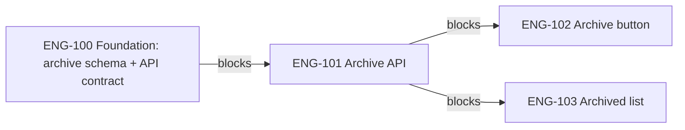

# Acceptance criteria, traceability, and Mermaid diagrams

Read this when you write a ticket's **Acceptance criteria**, or the dependency diagram in the intent brief.

## Acceptance criteria

- Write **at least one AC per REQ**, tagged with the REQ it checks.
- Each AC is a `- [ ]` checkbox so a reviewer or agent can tick it once verified.
- For behavior, write the AC as a Gherkin scenario: **Given** (start state), **When** (one action), **Then** (one observable result). Use **And** only for one more Given or Then.
- Every Then is testable: a value, a status code, a visible element, a row in a table. Not "works correctly".
- Every AC has a **Verify** line (the test, preview check, or command that runs on the PR) and an **Evidence** line (what CI or the preview produces). See the main skill for why every AC must be provable before merge.

```markdown
## Acceptance criteria
- [ ] **AC-1 (REQ-002):** Given 3 active members are selected, When the admin selects "Archive", Then the 3 members show under Archived.
  - Verify: e2e `members/archive.spec.ts` › "bulk archive" on the PR preview
  - Evidence: CI test pass + 15s recording
- [ ] **AC-2 (REQ-004):** Given a user without the admin role, When the user calls POST /members/archive, Then the API returns 403.
  - Verify: api `archive.test.ts` › "rejects non-admin"
  - Evidence: CI test pass
```

## Traceability: REQ → AC → TEST

Nothing gets built without a check. The AC tags and Verify lines above **are** the trace: each REQ maps to at least one AC, and each AC names its test. A REQ with no AC, or an AC whose Verify names no test or check, is a gap. Fill it before the ticket is ready. If the test does not exist yet, write the planned test name; the ticket's PR adds it.

The trace carries through to delivery: the PR's evidence lists each AC with the result of its Verify step at the reviewed commit.

For a ticket with many REQs, a table can make the trace easier to scan. It is optional:

```markdown
| REQ | AC | Test |
| --- | --- | --- |
| REQ-002 | AC-1 | e2e: `members/archive.spec.ts` › "bulk archive" |
| REQ-004 | AC-2 | api: `archive.test.ts` › "rejects non-admin" |
```

## Mermaid diagrams

Linear renders `mermaid` code blocks. Use them so a human can review the plan's shape at a glance:

- In the **intent brief**: a flowchart of ticket dependencies (A blocks B), with the foundation ticket first.
- In a **complex ticket**: a REQ → AC → TEST graph.

Keep each diagram small (≤12 nodes). Use ticket IDs and REQ/AC IDs, not long labels.


